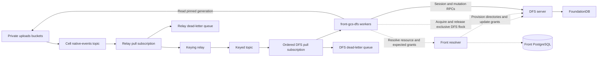

# GCS replication into DFS

## DFS virtual admin subject

DFS provides a reserved virtual admin subject with tenant-wide administrative access. Use it for DFS operations performed through Front's `Authenticator.internalAdminForWorkspace` and by the GCS replication worker. Each session remains bound to one tenant. The protocol defines the subject; Front does not represent it as a user record.

**Only the DFS server/master key can create a session containing this subject.** Add a master-key-authenticated session-creation path that takes an explicit tenant ID; DFS supplies the reserved subject. Ordinary tenant-key session creation must reject this subject, even when the caller submits its exact string. User, group and workspace-role membership cannot confer it.

This requires a DFS protocol/server change: reserve the subject, restrict its issuance and implement its administrative authorization. Current `CreateSession` authenticates a tenant key and accepts caller-supplied subjects. Sources: [session creation](https://github.com/dust-tt/dust/blob/355f1eadf9998dca8a69fc5662e185d79e9b9229/dfs/server/src/api.rs#L82), [Front internal admin authenticator](https://github.com/dust-tt/dust/blob/355f1eadf9998dca8a69fc5662e185d79e9b9229/front/lib/auth.ts#L1171).

**DFS authorizes this subject independently of file/directory grants, including DENYs.** Front does not add admin ALLOWs to tenant roots, directories or files. The worker still follows source bindings and acquires the required locks.

Validate master-key issuance, rejection with tenant/session keys, admin access through DENYs without local ALLOWs, and isolation between tenants.

## Event flow



1. GCS publishes native events.
2. A lightweight relay republishes them with an ordering key.
3. Workers pull keyed batches, resolve Front permissions, then write to DFS.

Two topics let the relay add keys. Ordered delivery gives one outstanding batch per key, simplifying worker scaling. It does not restore GCS mutation order. Coalesce events for an object by reconciling live GCS state; timestamps alone cannot establish causality. [Pub/Sub ordering](https://docs.cloud.google.com/pubsub/docs/ordering#pull_subscriber_clients).

## Scaling

All importer pods use one ordered subscription. Unary Pull allows one outstanding batch per key:

```text
Pod 1: A1, A2, A3 — serial
Pod 2: B1, B2     — serial, concurrent with A
```

A batch may contain several keys. Serialize each key locally; process different keys concurrently.

## Reconciliation

Events can duplicate or reorder. Each triggers reconciliation.

Apply source exclusions before provisioning or writing to DFS. Acknowledge excluded objects without creating DFS files or grants.

1. **Lock.** Validate bucket, workspace and tenant. Acquire the source's exclusive DFS lock.
2. **Prepare parent and check.** Resolve the Front resource and destination IDs. Create or reuse its pod, space or conversation directory. Confirm the directory's grants before adding files. Verify inherited permissions and any file-specific exceptions. Read the DFS completion marker, then live GCS metadata. Matching source, generation and metageneration: skip copying.
3. **Write.** First import creates the file under that directory and stores its ID. The file inherits its parent's grants. Later imports reuse it. Clear the marker and confirm before changing bytes. Read the exact GCS generation, write from offset zero, set final size and metadata. Check every operation result. Set the marker only after success. Authoritative live-object 404: remove the mapped DFS file instead.
4. **Unlock and acknowledge.** Only after durable write, deletion or verified equal state.

### Completion marker xattr

```

front.gcs_sync = {
  "bucket": "private-uploads",
  "objectName": "w/W/pods/P/files/report.csv",
  "generation": "12345",
  "metageneration": "1"
}
```

`front.gcs_sync` records the last complete copy. `objectName` is the full key inside the bucket, without the bucket name.

Missing marker: rewrite. Clear it before every attempt, including same-generation retries, so crashes cannot mark partial bytes complete.

Direct writes. The lock serializes importers. Readers ignoring it may see partial contents.

## What is written

GCS supplies bytes and events. Front supplies destinations and permissions. Destination layout follows the [DFS URI design](https://github.com/dust-tt/dust/blob/16b97dc5e5677ed9df792bb6c0394282abe5cdd1/dfs/design-docs/URI.md).

```text
<tenant-root>/users/user-<userSId>/
  pods/pod-<podSId>/
  conversations/conv-<conversationSId>/
```

Front should provision parents first. It creates each resource directory with the correct read/write grants and stores its ID (meaning resources get a column for dfs object_id, like pods, conversations etc). Workers reuse that directory for every file in the resource. Ordinary subdirectories and files have no local grants; DFS derives their permissions from their ancestors.

| Source | DFS destination |
| --- | --- |
| Conversation/pod `files/{path}` | create relative to the context folder ID|
| Upload objects: `files/w/{w}/{f}/{original,processed}` | obviously we keep original and processed, with the same anchor following current gcs convention |
| Skills, folder documents, workspace assets | dedicated skill, space or workspace folders with stored IDs and matching grants. |
| Non-Frame fragments, checkpoints, outputs and runtime artifacts | each GCS object maps to its own DFS file ID. Separate grant scopes where permissions differ. |


We will need to design/create the tenant namespaces `skills/skill-<sId>`, `spaces/space-<sId>`, `workspace-assets/` or something along this way.

**Frames are excluded from this rollout.** Their sources, sharing rules and runtime artifacts add too much complexity for now. Their small share of total files makes a later GCS backfill manageable. (Frame andies, sorry not sorry).

One complete example to illustrate wtf this is about. GCS contains:

```text
w/W/pods/P/files/reports/q3.csv
```

Front knows that P is a pod in workspace W. Suppose its `group_permissions` give existing group G1 read access and G2 read/write access. We want this in DFS, under the user folder chosen by Front's destination layout:

```text
<tenant-root>/users/user-U/pods/pod-P/
  reports/
    q3.csv
```

P's directory carries the grants:

```text
DENY rw
ALLOW g:G1 r
ALLOW g:G2 rw
```

`reports/` and `q3.csv` have no local grants. They inherit P's: G1 can read and G2 can read/write. Being under U's user folder does not give U access to P. The worker uses DFS's virtual admin subject, so it can maintain the replica independently of these grants.

How we get there:

1. Front creates P's DFS directory with these grants and stores its directory ID on the pod resource.
2. The worker receives the GCS event, resolves W and P in Front, and gets that stored directory ID. If P is not provisioned yet, provision it before adding files.
3. Under the source's DFS lock, the worker creates `reports/` and `q3.csv`, copies the GCS bytes, and finishes the metadata and completion marker.
4. Store the mapping from this exact GCS bucket/object name to the DFS file ID. Later imports update that same file by ID.

End state: the file exists in DFS with P's permissions, without copying grants onto every file. Users' sessions only need their user/group IDs. A later DFS rename keeps the file ID; in `dfs://q3.csv--<file-id>`, the name is decorative.

## GCS path to front resource

**IF YOU ONLY READ ONE THING IN THIS DOCUMENT IT SHOULD BE THIS**

This is an attempt at having an exhaustive list of the different gcs objects naming patterns (mimicing a filesystem with folders), if you know a piece that is not there, PLEASE reach out. 
I am 99% confident this list is incomplete and we will discover stuff in the DLQ :).

| GCS path | Front lookup and scope |
| --- | --- |
| `files/w/{w}/{f}/{original,processed}` | `FileResource`: use case, metadata, owner, status, expected bucket. Skip Frames and unattached `conversation`/`tool_output` files with `userId: null`. |
| `w/{w}/conversations/{c}/files/{path}` | `ConversationResource`. Skip Frame-owned files and source directories. |
| `w/{w}/pods/{p}/files/{path}` | Pod `SpaceResource`. Skip Frame-owned files and source directories. |
| `content_fragments/w/{w}/assistant/conversations/{c}/content_fragment/{messageId}/{format}` | Conversation and message association; format's download policy. |
| `w/{w}/mcp_output_items/{actionId}/{item}` | Action type and owning execution; output reader's policy. Skip Frame-owned outputs. |
| `w/{w}/frames/{f}/...` | Skip the entire prefix. |
| `w/{w}/pods/{p}/state/...` | Workspace `{w}` and pod `SpaceResource` `{p}`. Litestream replica objects; no `FileResource`. Bind each source object to the pod's state scope, with service access rather than pod-reader grants. |
| `w/{w}/pods/{p}/sandbox-functions/{name}` | Pod `SpaceResource` plus `FileResource.fetchByMountFilePaths(auth, [objectName])`. Require exact workspace/path, `project_context`, matching metadata `spaceId` and sandbox-function content type. File reads follow pod read permission. |
| `w/{w}/branding/{logo,favicon,og}` | Published branding assets: skip replication for now; public delivery stays on GCS. The separate source uploads under `files/w/...` are replicated with private grants. |
| `conversation-window-checkpoints/w/{w}/conversations/{c}/...` | Conversation and rendering checkpoint; rendering reader's policy. |
| Unknown prefix in configured bucket | Alert and dead-letter for repair |
| Other buckets | Outside configured sources. |

## Destination grants

This describe mapping front's data ownership into DFS, this subject is much bigger and complex than what's in this document, we only attempt at sketching the treeline here, nothing more.

The 80/20 rule: map the owning resource's readers and writers, put grants on its directory, and let files inherit. Keep exceptions for actual ownership/access differences.

- **Original and processed files have the same permissions.** If you can write the original, you can write the processed one. Separate GCS objects, separate DFS IDs, same grants.
- Sessions carry user/group IDs. The importer does the resource lookup and grant mapping; the DFS admin subject handles internal operations.
- Preserve who can read and write, except for the explicit participant-only conversation policy below. Front keeps its application checks, such as preventing deletion of a referenced skill attachment. Direct DFS operations follow DFS's existing file/parent `r/w` rules; we are not reproducing every Front endpoint's behavior in DFS.
- Keep every source family accounted for below. A known internal object without an established user-facing policy gets admin-only access. Missing ownership remains a mapping error, not permission to grant workspace-wide access.

| Actor | DFS access |
| --- | --- |
| DFS virtual admin subject | Tenant-wide administrative access, independent of object grants. Used by Front's internal workspace admin operations and the GCS replication worker. |
| User `u:<userId>` | Importer maps the user's Front permissions to `r`, `w` or `rw` grants. |
| Group `g:<groupId>` | Importer maps the existing Front group's permissions to `r`, `w` or `rw` grants. |

### Conversation attachments and tool outputs

For `conversation` and `tool_output`, resolve `useCaseMetadata.conversationId` in the same workspace. For conversation-path objects, resolve the conversation ID from the path.

**Desired end state: only the conversation owner and people they invited (participants) can list, read or write its folder and files.** This applies to standalone conversations, pod conversations and sub-conversations, regardless of `privateConversationUrlsByDefault` or URL access mode.

Read the owner and current invited participants from Front. Grant each user `rw` on the conversation directory, after clearing inherited access with `DENY rw`. Files and subdirectories inherit. Workspace membership, pod/space access and `requestedSpaceIds` do not determine these grants. The DFS virtual admin subject retains its internal administrative access.

Apply the same owner/participant policy to attached `conversation`/`tool_output` uploads and every conversation-path copy, including original and processed versions. Copies outside the conversation directory need the same access boundary. Pod shared files (`pods/{p}/files/...`) keep their separate space read/write policy.

Example: Alice owns C and invites Bob. Both can list, read and write C's folder and files. Carol can read C's pod and every requested space, but cannot see C's folder or files because she was not invited.

This is the target policy for Front and DFS; current Front handlers do not yet enforce it uniformly. Update conversation and file access checks to use owner/participant membership. Front must record explicit invitations; broader space access must not silently enroll someone as a participant. Current checks: [conversation authorization](https://github.com/dust-tt/dust/blob/355f1eadf9/front/lib/resources/conversation_resource.ts).

### Unattached conversation files and tool outputs

No `useCaseMetadata.conversationId`:

- `userId` set: uploader `rw` until attachment. Workspace membership or an unrelated API key is insufficient.
- `userId` null: skip replication and acknowledge. This applies to unattached `conversation`/`tool_output` uploads.

Attachment sets `conversationId` and copies the upload into `w/{w}/conversations/{c}/files/{fileName}`. The `files/w/{w}/{f}/` objects remain. A processed version also gets a separate copy beside the original; both use the same permissions. Sources: [attachment](https://github.com/dust-tt/dust/blob/80d0911554a376581c657a407c480ff9f99b21bf/front/lib/api/files/attachments.ts), [mount copy](https://github.com/dust-tt/dust/blob/80d0911554a376581c657a407c480ff9f99b21bf/front/lib/resources/file_resource.ts#L1885).

Import the copies from their GCS events, including copies of previously skipped service uploads. Front also switches already-imported upload objects from uploader grants to conversation grants. Their unchanged bytes do not produce a new GCS event.

### Pod context and folder documents

Space files here mean documents uploaded into a space's data-source folder (`folders_document`). The [upload UI](https://github.com/dust-tt/dust/blob/80d0911554a376581c657a407c480ff9f99b21bf/front/components/data_source/MultipleFilesUpload.tsx) sets `useCaseMetadata.spaceId` from the data-source view. Their bytes use `files/w/{w}/{f}/{original,processed}` keys; there is no separate space-file prefix. Pod uploads use `project_context` and the pod file mapping instead.

Resolve `useCaseMetadata.spaceId` through `SpaceResource.fetchById`.

| Case | Read rule | Write rule |
| --- | --- | --- |
| Pod shared files (`pods/{p}/files/...`) | Existing pod; `auth.can("read", space)`. | Pod access plus `auth.can("write", space)`. Applies to objects without a file row too. |
| `project_context` upload under `files/w/...` | Existing readable space; `space.isProject()` must pass. | Same access checks plus `auth.can("write", space)` for upload/replacement. |
| `folders_document` upload under `files/w/...` | Existing readable space; no project-type requirement. | Read check plus `(file author AND space write) OR workspace manager` for upload/replacement. |

Use Front's group/role checks for each permission. Uploading does not preserve access after losing the required space. A folder-document reader is not automatically its writer. [Source](https://github.com/dust-tt/dust/blob/80d0911554a376581c657a407c480ff9f99b21bf/front-api/routes/w/%5BwId%5D/files/%5BfileId%5D/index.ts#L358).

### Skill attachments

[fetchFileSkills](https://github.com/dust-tt/dust/blob/355f1eadf9/front/lib/resources/skill/skill_resource.ts#L1241) checks current `SkillFileAttachmentModel`; absent that, searches skill-version history.

- References exist: require at least one readable associated skill. No metadata fallback.
- No references: require readable `useCaseMetadata.skillId`. Missing/inaccessible skill denies.
- Skill readability requires skill read permission and every requested space. Use the resource fetch path, including exceptions.

Example: history references A and B. Reading A suffices; reading neither denies, even for the uploader. Recompute policy when attachments, history, skill permissions or required spaces change.

Write uses `canWriteSkillFile`: at least one fetched referencing skill must pass `auth.can("write", skill)`. Without references, require write on metadata `skillId`. Without either, require the uploader and `auth.hasWorkspacePermission("create", "skill")`. That last case can allow upload without read access; preserve `w` independently. [Write check](https://github.com/dust-tt/dust/blob/80d0911554a376581c657a407c480ff9f99b21bf/front-api/routes/w/%5BwId%5D/files/%5BfileId%5D/index.ts#L529).

### Avatar and branding uploads under `files/w/...`

This section covers private source uploads, not the published branding assets. Front copies a branding upload's processed bytes to `w/{w}/branding/{logo,favicon}` and generates `w/{w}/branding/og` separately. Those published objects stay out of replication until public access is designed. Copying the source upload into DFS does not publish it or change how public branding is served. [Branding publication](https://github.com/dust-tt/dust/blob/355f1eadf9/front/lib/api/workspace_branding/index.ts#L122).

Original and processed objects use the same mapping:

| Object | Read | Replace contents | Delete or rename |
| --- | --- | --- | --- |
| `avatar` | Workspace-authorized caller | Workspace-authorized caller | Workspace manager |
| `workspace_branding` | Workspace-authorized caller | Workspace manager | Workspace manager |

Create the containing workspace-assets directory with:

```text
DENY rw
ALLOW g:<workspace-group-id> r
ALLOW u:<manager-user-id> rw
```

Use the existing workspace group and one grant per manager, or an existing group matching that role. Branding originals and processed files inherit. Avatar originals and processed files also grant the workspace group `w` locally. Users can edit avatars; parent `w` restricts deletion/rename to managers. This fits the existing DFS grants without extra permissions.


### Upsert documents and tables

Nothing to see. Go Away.

### Internal artifacts and runtime state

| Artifact | DFS policy |
| --- | --- |
| Content fragments (`raw`, `text`) | Verify the conversation/message association, then use conversation `rw` for both representations. |
| Window checkpoints | Resolve the owning conversation; keep rendering checkpoints admin-only. |
| MCP outputs | Resolve the action and owning execution. Reuse its established user-facing resource policy; otherwise admin-only until mapped. Skip Frame-owned outputs. |
| Pod state | Resolve the pod; replicate Litestream state as admin-only internal data. No file row required. |
| Pod function bundles | Resolve the exact mounted `FileResource` and owning pod. Use the same pod read/write policy as other `project_context` files. |

Sources: [fragment download](https://github.com/dust-tt/dust/blob/355f1eadf9/front-api/routes/w/%5BwId%5D/assistant/conversations/%5BcId%5D/messages/%5BmId%5D/raw_content_fragment/index.ts), [checkpoint storage](https://github.com/dust-tt/dust/blob/355f1eadf9/front/lib/api/assistant/conversation_rendering/conversation_window_checkpoint.ts), [MCP output storage](https://github.com/dust-tt/dust/blob/355f1eadf9/front/lib/resources/agent_mcp_action/output_storage.ts).

Admin-only directories use `DENY rw` with no user/group ALLOWs. DFS's virtual admin subject still has access. These objects are replicated, not skipped. Keep the outstanding MCP ownership/access mapping visible; do not invent a separate writer policy for each generated representation.

Frames, including sharing/publications/runtime artifacts, are excluded as stated above. Unknown prefixes still need a mapping; they never inherit workspace access by default.

## Translating Front policy into DFS grants

**User sessions contain identity and group membership. The importer computes resource access and writes grants.** Front supplies `u:<userId>` and `g:<groupId>` subjects for the caller's actual groups. It does not load every accessible pod, space or conversation when creating a session. Internal admin sessions use the DFS-provided virtual subject described above.

For pods and spaces, read applicable `group_permissions` rows, including applicable type-wide grants. Expand their roles through Front's permission registry and apply resource-specific rules. Map the resulting read/write access to existing `g:<groupId>` grants. Resolve access granted by user roles or ownership separately. A `group_permissions` row alone is not always the complete policy.

For example, if group G1 can read pod P and group G2 can read and write it:

```text
ALLOW g:G1 r
ALLOW g:G2 rw
```

Alice's session contains `u:Alice` and her existing groups. Membership in G1 grants read; membership in G2 grants read/write. No pod-specific subject is needed. Sources: [group permission records](https://github.com/dust-tt/dust/blob/355f1eadf9998dca8a69fc5662e185d79e9b9229/front/lib/resources/storage/models/group_permissions.ts), [space permission rules](https://github.com/dust-tt/dust/blob/355f1eadf9998dca8a69fc5662e185d79e9b9229/front/lib/resources/space_resource.ts#L2100).

**Every conversation uses explicit owner/participant grants.** Import the owner and current invited participants as `u:<userId>` ALLOWs. No space intersection calculation or group grants are needed for conversation access.

Example: Alice owns C and invited Bob. C's directory grants are:

```text
DENY rw
ALLOW u:Alice rw
ALLOW u:Bob rw
```

Alice and Bob use their existing user subjects. Everyone else receives no grant, including other pod members. Descendants have empty local grants and inherit this boundary. DFS requires directory `r` to list it and returns only children with `r`, so unauthorized users cannot discover C through a parent listing. [DFS permission checks](https://github.com/dust-tt/dust/blob/355f1eadf9998dca8a69fc5662e185d79e9b9229/dfs/design-docs/API.md#L249).

Front updates these grants directly on invitation, participant removal or ownership change. Update the conversation boundary and any separately stored upload copies. Removing Bob removes his ALLOW everywhere; his unchanged `u:Bob` session no longer grants access. No GCS event or periodic check is needed. Reconcile the same owner/participant set during import.

For example, the user directory `users/user-<userSId>/` has:

```text
DENY rw
ALLOW u:<userId> rw
```

`DENY rw` clears inherited read/write permissions; the local ALLOW restores the user's access. Children inherit that result. DFS's virtual admin access is independent of this grant evaluation. [Grant inheritance for ordinary subjects](https://github.com/dust-tt/dust/blob/80d0911554a376581c657a407c480ff9f99b21bf/dfs/design-docs/API.md#L214).

Exceptions get local grants on the smallest affected subtree or file. For example, a folder document can inherit space read access but needs `DENY w` and explicit writer ALLOWs when its write policy is narrower. Conversation directories use their conversation policy; service-only artifacts use their own restricted scope. Set parent write grants from Front's namespace-mutation policy.

Front provisions and updates these policy boundaries. Importers verify ancestor grants and local exceptions against the intended user/group permissions. Empty file grants are expected; unexpected local ALLOWs or DENYs are drift. Unresolved scope or incorrect effective permissions blocks import, even though the worker has admin access.

Explicit user lists must fit DFS's 512-grant limit per object, including DENY entries. With one DENY, a conversation can grant access to at most 511 distinct owners/participants. Larger participant lists need a capacity solution before rollout; do not truncate the list or broaden access. [Grant limit](https://github.com/dust-tt/dust/blob/355f1eadf9998dca8a69fc5662e185d79e9b9229/dfs/server/src/storage/resources/object.rs#L33).
