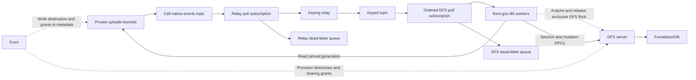

# GCS replication into DFS

## Event flow



1. GCS publishes native events.
2. A lightweight relay republishes them with an ordering key.
3. Workers pull keyed batches, read the destination and local grants from live GCS metadata, then copy bytes and apply those grants. Required metadata is backfilled on existing objects before import.

Why bothering with two topic ?
The second is ordered and this gives us a nice feature: Ordered delivery gives one outstanding batch per key, simplifying worker scaling. [Pub/Sub ordering](https://docs.cloud.google.com/pubsub/docs/ordering#pull_subscriber_clients).

## Destination and grants in GCS metadata

To ease the migration, Front will now write the DFS GRANTS in each gcs object as metadata.
This avoid reading back front and writing complex permission reverse-engineering code.

Store this as a JSON string in GCS custom metadata. The decoded value uses the protocol's `Grant` shape:

```json
{
  "parentId": "0190c3a0b1c27d4e8f0a1b2c3d4e5f60",
  "path": "reports/q3.csv",
  "grants": [
    { "deny": { "mode": 6 } },
    { "allow": { "subject": "g:G1", "mode": 4 } },
    { "allow": { "subject": "g:G2", "mode": 6 } }
  ]
}
```


The worker reads *live* metadata, not an old event payload. A metadata-only change reconciles local grants even when bytes are unchanged.
Objects without DFS metadata are ignored and acknowledged. 
Backfill adds the destination and grants to existing in-scope objects; the metadata-update event then triggers import. 

The remaining issue is keeping permissions current. If Front changes a file's local grants, it must update that metadata and DFS; asynchronous events alone leave a revocation delay. 

This is a non-issue if we have separate columns for dfs path and gcs path in front (which I think we will), we simply decide to update gcs metadata or directly dfs, knowing that dfs not null means DFS, and GCS otherwise.


## Authorization contract

DFS enforces file access through its grants. 
Front authorizes access to the conversation URL. 
The migration must preserve or narrow existing permissions, never enlarge them. 
How Front authorization translates into lasting DFS access is an explicit sharing decision below.

Pod permissions are convoluted, access to a conversation does not automatically grant access to its files, at least in write, regardless of what gave you access to the conversation itself.
**Because of that, we will follow the following principle : if you can read a conversation, you can read its files, likewise for write, right now access to conversation means rw.**


### Conversation folders and URL sharing

Standalone conversation folders live in `/users/{userEmail}/conversations/`. They inherit **one user grant** from `/users/{userEmail}/`; there is no owner grant to duplicate on every conversation or file.

```text
/users/alice@example.com/                 ALLOW u:Alice rw
  conversations/                         no local grants
    conv-C/                              no local grants
      report.csv                         no local grants
```

Sharing C's conversation URL does not grant access to its DFS files. We have two choices:

1. **Do nothing.** Another user can open the conversation if Front allows it, but cannot browse its DFS files.
2. **Grant access on first visit.** When another user opens the URL and passes Front's conversation access checks, Front creates a just-in-time grant for that user on C's folder. The folder then appears in their `/shared`. A read grant is enough for browsing; any write grant must also satisfy the file mutation rules. The grant applies only to C, not to Alice's other conversations.

This is the tension between DFS and Front being authoritative. But I think we can go with option 2.

Pod conversations keep their existing pod audience through explicit grants derived from pod access.
They are the shared exception to the standalone user-scoped default.

## DFS virtual admin subject

Proposed DFS protocol change: provide a reserved virtual admin subject with tenant-wide administrative access. The GCS replication worker uses it. Front requests it explicitly for operations that must bypass object grants, such as provisioning a user's personal directory. Each session remains bound to one tenant.

**Only the DFS server/master key can create a session containing this subject.** Add a master-key-authenticated session-creation path that takes an explicit tenant ID; DFS supplies the reserved subject. 

This requires a DFS protocol/server change: reserve the subject, restrict its issuance and implement its administrative authorization. Current `CreateSession` authenticates a tenant key and accepts caller-supplied subjects. Sources: [session creation](https://github.com/dust-tt/dust/blob/355f1eadf9998dca8a69fc5662e185d79e9b9229/dfs/server/src/api.rs#L82), [Front internal admin authenticator](https://github.com/dust-tt/dust/blob/355f1eadf9998dca8a69fc5662e185d79e9b9229/front/lib/auth.ts#L1171).

**DFS authorizes this subject independently of file/directory grants, including DENYs.** 


## Scaling

All importer instances use one ordered subscription. Unary Pull allows one outstanding batch per key:

```text
Worker 1: A1, A2, A3 — serial
Worker 2: B1, B2     — serial, concurrent with A
```

A batch may contain several keys. Serialize each key locally; process different keys concurrently.

## Reconciliation

Events can duplicate or reorder. Each triggers reconciliation.

Apply source exclusions before provisioning or writing to DFS. Acknowledge excluded objects without creating DFS files or grants.

1. **Lock.** Validate the configured bucket, workspace and tenant. Acquire the source's exclusive DFS lock.
2. **Read and check.** Read the destination and local grants from live GCS metadata. If DFS metadata is absent, ignore the object and acknowledge the event. Invalid metadata goes to the DLQ. Verify the destination and inherited permissions. For objects with metadata, skip copying only when the source, generation, metageneration and local grants already match.
3. **Write.** First import creates the file under the provisioned directory and durably stores the source-to-file mapping. Later imports reuse its ID. Clear the completion marker before changing bytes or grants. Read the exact GCS generation, write from offset zero, set final size and metadata, and apply local grant changes under the chosen authority rule. Check every result and set the marker only after success. An authoritative live-object 404 removes only the mapped file; a stale event must not recreate a deleted resource.
4. **Unlock and acknowledge.** After durable write, deletion, deliberate exclusion, missing metadata or verified equal state. Missing metadata requires neither retries nor a DLQ entry.

### Completion marker xattr

```

front.gcs_sync = {
  "bucket": "private-uploads",
  "objectName": "w/W/pods/P/files/report.csv",
  "generation": "12345",
  "metageneration": "1"
}
```

`front.gcs_sync` records the last complete copy.

Missing marker: rewrite. Clear it before every attempt, including same-generation retries, so crashes cannot mark partial bytes complete.

Direct writes. The lock serializes importers. Readers ignoring it may see partial contents.

## What is written

GCS supplies bytes and events. Front supplies destinations and permissions. Destination layout follows the [DFS URI design](https://github.com/dust-tt/dust/blob/16b97dc5e5677ed9df792bb6c0394282abe5cdd1/dfs/design-docs/URI.md).

```text
<tenant-root>/users/<user-email>/
  pods/pod-<podSId>/
  conversations/conv-<conversationSId>/
```

Front provisions resource directories and stores their DFS object IDs on the corresponding resources. 

| Source | DFS destination |
| --- | --- |
| Conversation/pod `files/{path}` | Create relative to the stored context directory ID. |
| Upload objects: `files/w/{w}/{f}/{original,processed}` | Keep original and processed objects under the same file policy boundary, with separate DFS IDs. |
| Skills, folder documents, workspace assets | Dedicated skill, space or workspace folders with stored IDs and matching grants. |
| Non-Frame fragments, checkpoints, outputs and runtime artifacts | Each GCS object maps to its own DFS file ID. Separate grant scopes where permissions differ. |


Tenant namespaces for skills, spaces and workspace assets still need to be defined. Their stored directory IDs identify the destination parents.

**Frames are excluded from this rollout.** Their sources, sharing rules and runtime artifacts require a separate design and later backfill.

For example, GCS contains:

```text
w/W/pods/P/files/reports/q3.csv
```

Front knows that P is a pod in workspace W. Suppose its `group_permissions` give existing group G1 read access and G2 read/write access. We want this in DFS, under the user folder chosen by Front's destination layout:

```text
<tenant-root>/users/alice@example.com/pods/pod-P/
  reports/
    q3.csv
```

P's directory carries the grants:

```text
DENY rw
ALLOW g:G1 r
ALLOW g:G2 rw
```

`reports/` and `q3.csv` have no local grants. They inherit P's: G1 can read and G2 can read/write. Being under Alice's user folder does not give Alice access to P. The worker uses DFS's virtual admin subject, so it can maintain the replica independently of these grants.

How we get there:

1. Front creates P's DFS directory with these grants and stores its ID. The GCS writer records that parent ID, `reports/q3.csv` and `grants: []` in the object's metadata.
2. The worker receives the GCS event and reads this metadata. Existing objects must have been backfilled with the same fields.
3. Under the source's DFS lock, the worker creates `reports/` and `q3.csv` and durably records the source-to-file mapping before copying bytes.
4. The worker copies the pinned GCS generation and finishes the metadata and completion marker. Later imports update that same file by ID.

End state: the file exists in DFS with P's permissions, without copying grants onto every file. Users' sessions only need their user/group IDs. A later DFS rename keeps the file ID; in `dfs://q3.csv--<file-id>`, the name is decorative.

## Metadata producers and backfill

Upload paths and the backfill use the following source inventory to populate destination and grant metadata. These lookups happen when producing metadata, never in the replication worker. The backfill flags unknown sources for review; objects without DFS metadata remain ignored.

| GCS path | Metadata producer / backfill context |
| --- | --- |
| `files/w/{w}/{f}/{original,processed}` | `FileResource`: use case, metadata, owner, status, expected bucket. Skip Frames and unattached `conversation`/`tool_output` files with `userId: null`. |
| `w/{w}/conversations/{c}/files/{path}` | `ConversationResource`. Skip Frame-owned files and source directories. |
| `w/{w}/pods/{p}/files/{path}` | Pod `SpaceResource`. Skip Frame-owned files and source directories. |
| `content_fragments/w/{w}/assistant/conversations/{c}/content_fragment/{messageId}/{format}` | Conversation and message association; format's download policy. |
| `w/{w}/mcp_output_items/{actionId}/{item}` | Action type and owning execution; output reader's policy. Skip Frame-owned outputs. |
| `w/{w}/frames/{f}/...` | Skip the entire prefix. |
| `w/{w}/pods/{p}/state/...` | Workspace `{w}` and pod `SpaceResource` `{p}`. Litestream replica objects; no `FileResource`. Bind each source object to the pod's state scope, with service access rather than pod-reader grants. |
| `w/{w}/pods/{p}/sandbox-functions/{name}` | Pod `SpaceResource` plus `FileResource.fetchByMountFilePaths(auth, [objectName])`. Require exact workspace/path, `project_context`, matching metadata `spaceId` and sandbox-function content type. File reads follow pod read permission. |
| `w/{w}/branding/{logo,favicon,og}` | Published branding assets: skip replication for now; public delivery stays on GCS. The separate source uploads under `files/w/...` are replicated with private grants. |
| `conversation-window-checkpoints/w/{w}/conversations/{c}/...` | Conversation and rendering checkpoint; rendering reader's policy. |
| Unknown prefix in configured bucket | Backfill flags it for review. The worker ignores it if DFS metadata is absent. |
| Other buckets | Outside configured sources. |

## Destination grants

The metadata producers and backfill use each source's existing Front readers and writers as the permission ceiling. Standalone conversation files start with the narrower inherited user grant; URL visitors get a grant only if we choose just-in-time sharing.

- Original and processed versions of the same source use the same policy, with separate DFS IDs. Canonical uploads and mount copies may have different mutation rules and therefore different boundaries.
- Front provisions grants; DFS enforces them. Sessions carry only subjects justified by the caller's identity and actual authorization scope. The importer maintains bytes using its separate administrative session.
- A direct DFS operation must not bypass a Front restriction. If DFS's `r/w` model cannot preserve a check, narrow the grant or keep that operation behind Front. For example, referenced skill attachments must not become directly deletable.
- Known internal objects without a user-facing policy remain service-only. Missing ownership is a mapping error, never a reason to grant workspace-wide access.

| Actor | DFS access |
| --- | --- |
| DFS virtual admin subject | Explicit maintenance bypass, restricted to one tenant. Not issued merely because a caller has a workspace admin role. |
| User `u:<userId>` | Only the operations permitted by Front for this caller and scope. |
| Group `g:<groupId>` | Only the operations justified by that existing Front group's effective permissions. |

### Conversations, attachments and tool outputs

Resolve attached `conversation` and `tool_output` uploads through `useCaseMetadata.conversationId` in the same workspace. Conversation-path objects resolve through the path's conversation ID. The following are Front's current checks for opening a conversation, including the checks before issuing a JIT grant if we choose that option. They do not automatically create DFS grants for everyone who passes them. [Conversation authorization](../../front/lib/resources/conversation_resource.ts):

| Conversation | Current Front read rule for ordinary user sessions |
| --- | --- |
| Pod conversation (`spaceId` set) | The pod must exist and the caller must be able to read it. Additional `requestedSpaceIds` do not restrict conversation visibility. Participation and private-by-default URL settings are not extra gates. |
| Standalone conversation (`spaceId` null, `depth === 0`) | The caller must be able to read every requested space. When `privateConversationUrlsByDefault` applies and URL mode is `participants_only` (also the default mode under that setting), the caller must additionally be a participant. Otherwise Front permits access without participation. |
| Sub-conversation without a pod | Retain the requested-space checks. Front exempts sub-conversations from the private-by-default URL restriction; do not invent a participant-only rule for them. |

Deleted, missing or foreign required resources deny access. Front has explicit auth-method and support-user exceptions to the URL restriction; these are not a reason to grant all ordinary sessions broader access or a DFS administrative bypass.

For example, Carol can read pod P but cannot read restricted space S used by an agent in P's conversation C. Front still lets Carol open C; the pod conversation's grants preserve that audience. If C is standalone and requires S, inviting Carol does not let her bypass S or obtain a JIT grant.

Current Front file permissions set the upper bound for inherited or JIT access:

| Source | Read | Write/mutation boundary |
| --- | --- | --- |
| `conversations/{c}/files/...` mount | Conversation access | Front's conversation mount is read/write once conversation access succeeds. |
| Pod shared `pods/{p}/files/...` | Pod read | Pod write. A pod reader need not be a pod writer. |
| Attached canonical `conversation` upload | Conversation access | Preserve the file endpoint's conversation access checks for replacement/deletion. Rename has its own manager check. |
| Attached canonical `tool_output` upload | Conversation access | Retain the file endpoint's additional mutation checks, including its manager restriction where applicable. Do not grant every conversation reader `rw` on this copy. |

Sources: [filesystem mounts](../../front/lib/api/file_system/dust_file_system.ts), [file access and mutations](../../front-api/routes/w/[wId]/files/[fileId]/index.ts), [file rename](../../front-api/routes/w/[wId]/files/[fileId]/rename.ts). In particular, pod conversation mounts and pod shared files cannot blindly inherit the same `rw` grants: Front gives them different write rules. DFS parent/target `w` checks also cannot distinguish every Front mutation rule; retain those operations behind Front or narrow direct writes.

With inherited user access alone, other URL viewers cannot browse the standalone conversation folder. Under JIT sharing, the explicit folder grant makes that conversation discoverable in the visitor's `/shared`. Do not grant workspace-wide discovery or create grants for all potential URL viewers in advance.

### Unattached conversation files and tool outputs

No `useCaseMetadata.conversationId`:

- `userId` set: only the uploader can read until attachment. Writes retain the use-case-specific file endpoint checks; an unattached tool output does not automatically grant its uploader `rw`. Workspace membership or an unrelated API key is insufficient.
- `userId` null: skip replication and acknowledge. This applies to unattached `conversation`/`tool_output` uploads.

Attachment sets `conversationId` and copies the upload into `w/{w}/conversations/{c}/files/{fileName}`. The `files/w/{w}/{f}/` objects remain. A processed version also gets a separate copy beside the original. Both mounted representations use the chosen conversation-folder sharing behavior; canonical uploads retain any stricter file endpoint rules. Sources: [attachment](https://github.com/dust-tt/dust/blob/80d0911554a376581c657a407c480ff9f99b21bf/front/lib/api/files/attachments.ts), [mount copy](https://github.com/dust-tt/dust/blob/80d0911554a376581c657a407c480ff9f99b21bf/front/lib/resources/file_resource.ts#L1885).

Import the copies from their GCS events, including copies of previously skipped service uploads. Front also switches already-imported upload objects to their attached-file policy, retaining any stricter mutation checks. It updates the destination and grants in GCS metadata and applies the permission change in DFS. Unchanged bytes alone produce no event; the proposed metadata patch does.

### Pod context and folder documents

Space files here mean documents uploaded into a space's data-source folder (`folders_document`). The [upload UI](https://github.com/dust-tt/dust/blob/80d0911554a376581c657a407c480ff9f99b21bf/front/components/data_source/MultipleFilesUpload.tsx) sets `useCaseMetadata.spaceId` from the data-source view. Their bytes use `files/w/{w}/{f}/{original,processed}` keys; there is no separate space-file prefix. Pod uploads use `project_context` and the pod file mapping instead.

Resolve `useCaseMetadata.spaceId` through `SpaceResource.fetchById`.

| Case | Read rule | Write rule |
| --- | --- | --- |
| Pod shared files (`pods/{p}/files/...`) | Existing pod; `auth.can("read", space)`. | Pod access plus `auth.can("write", space)`. Applies to objects without a file row too. |
| `project_context` upload under `files/w/...` | Existing readable space; `space.isProject()` must pass. | Same access checks plus `auth.can("write", space)` for upload/replacement. |
| `folders_document` upload under `files/w/...` | Existing readable space; no project-type requirement. | Read check plus `(file author AND space write) OR workspace manager` for upload/replacement. |

Use Front's group/role checks for each permission. Uploading does not preserve access after losing the required space. A folder-document reader is not automatically its writer. [Source](https://github.com/dust-tt/dust/blob/80d0911554a376581c657a407c480ff9f99b21bf/front-api/routes/w/%5BwId%5D/files/%5BfileId%5D/index.ts#L358).

### Skill attachments

[fetchFileSkills](https://github.com/dust-tt/dust/blob/355f1eadf9/front/lib/resources/skill/skill_resource.ts#L1241) checks current `SkillFileAttachmentModel`; absent that, searches skill-version history.

- References exist: require at least one readable associated skill. No metadata fallback.
- No references: require readable `useCaseMetadata.skillId`. Missing/inaccessible skill denies.
- Skill readability requires skill read permission and every requested space. Use the resource fetch path, including exceptions.

Example: history references A and B. Reading A suffices; reading neither denies, even for the uploader. Recompute policy when attachments, history, skill permissions or required spaces change.

Write uses `canWriteSkillFile`: at least one fetched referencing skill must pass `auth.can("write", skill)`. Without references, require write on metadata `skillId`. Without either, require the uploader and `auth.hasWorkspacePermission("create", "skill")`. That last case can allow upload without read access; preserve `w` independently. [Write check](https://github.com/dust-tt/dust/blob/80d0911554a376581c657a407c480ff9f99b21bf/front-api/routes/w/%5BwId%5D/files/%5BfileId%5D/index.ts#L529).

### Avatar and branding uploads under `files/w/...`

This section covers private source uploads, not the published branding assets. Front copies a branding upload's processed bytes to `w/{w}/branding/{logo,favicon}` and generates `w/{w}/branding/og` separately. Those published objects stay out of replication until public access is designed. Copying the source upload into DFS does not publish it or change how public branding is served. [Branding publication](https://github.com/dust-tt/dust/blob/355f1eadf9/front/lib/api/workspace_branding/index.ts#L122).

Original and processed objects use the same mapping:

| Object | Read | Replace contents | Delete or rename |
| --- | --- | --- | --- |
| `avatar` | Workspace-authorized caller | Workspace-authorized caller | Workspace manager |
| `workspace_branding` | Workspace-authorized caller | Workspace manager | Workspace manager |

Create the containing workspace-assets directory with:

```text
DENY rw
ALLOW g:<workspace-group-id> r
ALLOW u:<manager-user-id> rw
```

Use the existing workspace group and one grant per manager, or an existing group matching that role. Branding originals and processed files inherit. Avatar originals and processed files also grant the workspace group `w` locally. Users can edit avatars; parent `w` restricts deletion/rename to managers. This fits the existing DFS grants without extra permissions.


### Upsert documents and tables

This document does not define direct user access to upsert inputs. Known inputs remain service-only until their ownership and operation-specific Front checks are mapped.

### Internal artifacts and runtime state

| Artifact | DFS policy |
| --- | --- |
| Content fragments (`raw`, `text`) | Verify the conversation/message association and use the conversation folder's chosen DFS audience for both representations. Restrict it to `r`; keep writes service-only unless a Front mutation path authorizes them. |
| Window checkpoints | Resolve the owning conversation; keep rendering checkpoints admin-only. |
| MCP outputs | Resolve the action and owning execution. Reuse its established user-facing resource policy; otherwise admin-only until mapped. Skip Frame-owned outputs. |
| Pod state | Resolve the pod; replicate Litestream state as admin-only internal data. No file row required. |
| Pod function bundles | Resolve the exact mounted `FileResource` and owning pod. Use the same pod read/write policy as other `project_context` files. |

Sources: [fragment download](https://github.com/dust-tt/dust/blob/355f1eadf9/front-api/routes/w/%5BwId%5D/assistant/conversations/%5BcId%5D/messages/%5BmId%5D/raw_content_fragment/index.ts), [checkpoint storage](https://github.com/dust-tt/dust/blob/355f1eadf9/front/lib/api/assistant/conversation_rendering/conversation_window_checkpoint.ts), [MCP output storage](https://github.com/dust-tt/dust/blob/355f1eadf9/front/lib/resources/agent_mcp_action/output_storage.ts).

Admin-only directories use `DENY rw` with no user/group ALLOWs. DFS's virtual admin subject still has access. These objects are replicated, not skipped. Keep the outstanding MCP ownership/access mapping visible. A download path alone never establishes user write permission.

Frames, including sharing/publications/runtime artifacts, are excluded as stated above. Unknown prefixes still need a mapping; they never inherit workspace access by default.

