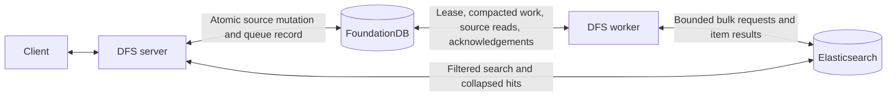

# dfs:// search proposal

## Tl;Dr

- Optimize for available, fast search. Maximum indexing lag is 30 minutes, including imports and
  large fan-outs. Revocations take a separate fast path, that is fast-tracked and expected to converge much faster.
  We will fine-tune ES to make it is the case and replication lag will be monitored.
- Put tenant, effective read subjects, scope, and metadata filters in Elasticsearch.
- Use one Elasticsearch content document per stored 64 KiB FDB block, passed as is.
  Duplicate searchable metadata and effective subjects on every chunk. Collapse hits by object.
- Store a durable indexing work queue in FDB. Enqueue work in the same transaction as the source
  changes. Workers consume the queue and handle block reads, descendant fan-out, retries, and
  Elasticsearch backpressure.
- Give the work queue partition offsets, consumer groups, and compaction: if an object already
  has pending work in that queue, bump its event's offset. Workers fetch current data from FDB.


## Availability and freshness

| Concern | Proposed behavior |
| --- | --- |
| Search latency | Initial benchmark targets: p95 below 150 ms, p99 below 300ms for a 20-hit response under concurrent ingestion. |
| Normal indexing | Source commit to searchable result within 30 minutes. |
| Bulk changes | Same 30-minute maximum, measured from the first outstanding change through traversal, publication, and refresh. |
| Revocations | Separate fast-track queue, read before normal work. Effective in search after affected chunks are indexed and refreshed. |
| Elasticsearch outage | Filesystem writes continue through FDB; indexing accumulates. Search returns `UNAVAILABLE` if no usable search backend remains. |
| Worker outage | Serve the existing index; resume from durable work. |
| FDB outage | Existing search can continue with valid cached session authentication and any required scope authorization. Writes require FDB. |
| Excessive backlog | Keep serving old results and alert on freshness |

## System design



The server never waits for Elasticsearch on a mutation. A successful FDB transaction commits both
the filesystem change and its indexing obligation. A failed transaction commits neither. Every
write path, including grant changes, tenant-root creation, and namespace replacement, participates.

The worker reads current source state, builds a projection, publishes it, then acknowledges durable
work. Elasticsearch calls run outside FDB transactions. Consumer groups let a new index
generation catch up independently of the serving generation.

## Elasticsearch documents

### Chunking

Use one live document for a directory or a file without indexed text. A file with text uses one or
more chunk documents. Each content chunk is onestored FDB block, passed as is.

Initial limits to benchmark:

| Limit | Starting value |
| --- | --- |
| Content per chunk | One stored FDB block, up to 64 KiB, unchanged. |
| Serialized Elasticsearch document | At most 1 MiB, including subjects and metadata. |
| Indexed content | Initially at most 8 MiB and 128 blocks per file |

For files beyond the indexing cap, index the first 128 blocks and record `content_truncated=true`.
For unsupported formats or text-decoding failures, publish metadata with an explicit internal content status. 

Consequences of using BM25 with chunks : long files get several chances to produce a strong matching chunk. Score
an object by its best chunk, boost name matches, and test relevance on long versus short files. 

### Fields

Use explicit mappings with dynamic mapping disabled. All documents carry:

| Field | Representation / use |
| --- | --- |
| `tenant_id`, `object_id` | Exact keywords. |
| `chunk_index` | Integer |
| `name` | Analyzed text plus exact keyword |
| `kind`, `mime_type` | Keywords. Normalize MIME type/subtype e.g. `Text/Plain; charset=UTF-8` becomes `text/plain` |
| `parent_id` | Keyword identifying the immediate parent. Used for non-recursive folder scope. |
| `ancestor_ids` | Keyword array of strict ancestors. Used for recursive folder scope. |
| `read_subjects` | Keyword array of effective subjects allowed to read this object. |
| `size` | `unsigned_long`, matching the protocol's byte count. |
| `atime`, `mtime`, `ctime`, `created` | Optional `unsigned_long` millisecond values |
| `xattrs` | One `keyword` array containing escaped key/value pairs for UTF-8 values and key-existence tokens. |
| `text` | Analyzed block content, empty for metadata-only objects. |
| `projection_revision`, `schema_version` | Publication ordering and rebuild compatibility. |

All filters are duplicated per chunk, including read subjects. Effective subject count can exceed
the 512-grant limit on one object because grants inherit. Never truncate subjects to make a document
fit. If ACL/metadata alone exceeds the document budget, quarantine that object's projection and
alert; define a larger supported budget or a different ACL representation before admitting that
workload. Missing results must be observable, not a silent success.

### Xattr

`K` is the key with backslashes and `=` escaped. `V` is the UTF-8 value. Binary values are excluded
from equality search; key-existence search still covers every xattr.

| Token | Purpose |
| --- | --- |
| `k:<K>` | Key existence. Emit for every entry. |
| `v:<K>=<V>` | Equality on the indexed UTF-8 value, truncated when necessary. An empty value produces `v:<K>=`. |

Truncate `V` at a UTF-8 character boundary so the complete `v:<K>=<V>` token fits within 32,766 bytes.
See [keyword limits](https://www.elastic.co/docs/reference/elasticsearch/mapping-reference/keyword).

Values with the same retained prefix match even if their discarded suffixes differ. This replaces
full byte-exact equality for oversized values in the [Search proposal](API.md#search). No hash
fallback, duplicated raw values, or post-search verification. FDB retains the full original value;
`Stat` with `include_metadata=true` retrieves it.


### Grants and write fan-out

Materialize **effective** read subjects, not the union of every attached grant. Starting at the
tenant root, maintain a set `R`:

```text
R = empty set
at each ancestor and then the object:
    if any local DENY contains r: R = empty set
    R = R union subjects of local ALLOW grants containing r
```

This matches DFS's subjectless DENY followed by local ALLOW. Write-only grants do not grant search
visibility. A local or deeper ALLOW can reopen a denied subtree. Query with an intersection between
`read_subjects` and the authenticated session's subjects.

| Change | Projection work |
| --- | --- |
| File bytes, attributes, or xattrs | Rewrite affected file chunks; metadata/ACL updates still rewrite every chunk carrying those fields. |
| File grant change or move | Recompute that file's subjects and scope; rewrite all its chunks. |
| Directory grant change | Recompute the directory and every affected descendant. |
| Directory move | Update the moved directory's parent ID; recompute subjects and ancestor IDs throughout the moved subtree. |
| Directory rename | Rewrite its own name; descendants need no path rewrite because paths are not indexed. |
| Directory ordinary metadata | Rewrite the directory only, unless the changed field is explicitly inherited. |
| Object removal / replacement | Tombstone the removed object's chunks; enqueue parent metadata and replacement object changes separately. |

The originating transaction inserts one resumable subtree job; it does not enumerate descendants.
Workers walk `child/<parent>/<name>` in bounded FDB transactions with durable traversal state. Each
batch commits discovered object obligations and traversal progress together. Repeated changes on
the same root coalesce; a changed root generation restarts or revisits the traversal. Each object
projection reads current ancestry rather than copying a stale ACL from the traversal job.


Fan-out cost is `sum(chunks per affected object)`, not just the descendant count. A change affecting
10M objects with two chunks each requires 20M document rewrites. At 5,000 successful document writes
per second, that alone takes about 67 minutes. Thirty-minute freshness requires at least 11,112 writes/s
for this event, plus capacity for block reads, traversal, refresh, and ordinary traffic.
We will size the ES cluster accordingly.

### Revocations while indexing catches up

Use two durable FDB work queues: normal and fast-track. Revocations, moves that can reduce inherited
access, search exclusions, and deletions enter the fast-track queue in the source transaction.
Workers check this queue before taking normal work. Descendant jobs and retries keep that priority.

Search continues using indexed subjects while workers catch up. A revoked subject may still see names and
excerpts until the affected chunks are indexed and refreshed. `Stat` and `Read` keep their existing
authorization checks. 

The fast-track queue avoids waiting behind ordinary content updates. It should usually have less
work, but a single large subtree revocation can still produce millions of chunk rewrites.
The overall freshness objective remains 30 minutes, fast-track work should converge much sooner.

## Index eligibility

Reserve the xattr `dfs.search.exclude`. Its presence excludes the object from all search, including
name and metadata; an empty value still excludes it. Removing it re-enables indexing. On a directory,
it excludes the entire subtree. A child cannot override an excluded ancestor.

Setting or removing the xattr creates a subtree job when needed. 

MIME policy controls **content indexing**, independently of all-search exclusion. Index accepted
text blocks directly, without parsing or transforming HTML, JSON, or XML.

Stating the obvious maybe but here are the mimetypes we will support initially.

| MIME range | Initial policy |
| --- | --- |
| `text/*` | Index stored blocks as text |
| `application/json`, `application/*+json` | Index stored blocks as text. |
| everything else | Metadata-only. |


## Durable FDB queue

| Property | Decision |
| --- | --- |
| Queues | `normal` and `fast-track`; workers read fast-track first. |
| Enqueue | Same FDB transaction as the source mutation. |
| Partitions | `hash(tenant_id, object_id) % partition_count`; start with 128 per queue, subject to benchmarks. |
| Offsets | FDB commit versionstamps; scoped to queue, partition, and partition layout version. Gaps from compaction are expected. |
| Consumer groups | One per Elasticsearch index generation; each group tracks its own partition offsets. |
| Ownership | Within a group, a worker can own multiple partitions; each partition has at most one worker, enforced by an exclusive lease. |
| Progress | The owning worker advances the partition's committed offset after all preceding events are processed or durably transferred to retry work. Compacted gaps are skipped. |
| Delivery | At least once. Acknowledge after successful indexing or durable transfer to retry work. |
| Retention | Keep unresolved work for active groups. Expired groups must backfill before resuming. |

On reassignment, the new owner resumes from the group's committed offset. Only the current lease
owner can commit progress; unacknowledged work may be replayed.

### Compaction

This is a queue of indexing events. Compact independently within each queue, keyed by
`(tenant_id, object_id)`. An object can have one pending event in each queue.
If another change targets the same queue before processing, replace its old entry at the new
commit's offset, in the same FDB transaction as the source change.

If an object already has a normal event and needs urgent indexing, enqueue a fast-track event.
Leave the normal event untouched. Both are consumed independently; neither queue moves, cancels,
or acknowledges events in the other.

Events identify the object and work needed; they do not contain `Attr`, `ExtendedMetadata`, or
block contents. Workers fetch current values from FDB. Block read ranges describe which blocks
to fetch; repeated writes combine those ranges without copying their contents into the queue.

Compaction preserves outstanding work within that queue, including descendant updates and chunk
removals. Keep the oldest pending timestamp for lag tracking;
acknowledge only the processed event version so a concurrent update stays pending.

### Increasing partitions

**Only increases are allowed.** Grow both queues together, for example 128 to 256. Worker count can
change independently through lease reassignment.

1. Create a new partition layout version with the larger count. Register its partitions in every active consumer group.
2. Switch producer routing atomically in FDB. Enqueue transactions read that routing with conflict
   tracking, so writes racing with the switch retry against the new layout.
3. Workers consume both layouts. Existing work drains from the old one; new writes go to the new one.
   A changed object carries its pending work, priority, and original enqueue time into the new layout.
4. Retire the old layout after all active groups finish its pending work, retries, and descendant jobs.

Keep each queue's compaction state independent of the partition layout. Publication revisions remain
per object across both queues, so older normal work cannot overwrite a newer fast-track result.
New partitions start with new offsets. Run one expansion at a time; after switching producers,
finish forward rather than shrink.

## Worker and backpressure

Workers will, for each queue (starting with the fast-track), for each event:

1. **Fetch the object from FDB.** Read its current attributes, xattrs, inherited read permissions,
   and the blocks identified by the event. Split large reads across short transactions.
2. **Check that the reads agree.** The object may change between transactions. Compare source
   versions across the reads; if they changed, reread the affected data before indexing. For example,
   do not combine a file's old size with blocks read after it was rewritten.
3. **Write the chunks to Elasticsearch.** Use `(tenant_id, object_id, block_offset)` as the document ID so
   reprocessing replaces the same document. Attach an increasing object revision to each publication;
   retries keep that revision. Elasticsearch must reject older revisions: a delayed normal write
   must not undo a newer fast-track update. Chunk removals also retain a revision so an older write
   cannot recreate them.
4. **Record completion.** A bulk request can succeed for some chunks and fail for others. Check
   each chunk's result. Advance the partition offset only after every required write or removal
   succeeds, or after saving the remaining work durably for retry. This lets other objects proceed
   without losing failed work.

**Control Elasticsearch backpressure by scaling the workers.** Reduce active workers when
Elasticsearch returns 429s or search latency rises. Increase workers gradually when Elasticsearch
has capacity and indexing is falling behind. Pending events stay in FDB and continue to compact.

Each worker has fixed limits on concurrent block reads and in-flight bulk requests, shared across
all its assigned partitions. Reassigning more partitions to fewer workers therefore reduces total
indexing concurrency. Remaining workers still read fast-track first.

Start with 2–8 MiB bulks and a 30-second refresh interval.
[Elastic indexing guidance](https://www.elastic.co/docs/deploy-manage/production-guidance/optimize-performance/indexing-speed).

Track each queue's oldest pending work and source-to-searchable lag, including refresh, to assess
the freshness cost of scaling down.

## Query path

- Authenticate the session; use its tenant and subjects, and authorize any supplied scope.
- Use the shared Elasticsearch alias initially. Once tenants target different indices, resolve
  the index from cached FDB placement metadata. Use that index's routing mode.
- Filter tenant, indexed subjects, and metadata in Elasticsearch. For folder scope, use `ancestor_ids`
  when `recursive=true` (the default), or `parent_id` when `recursive=false` to select immediate children only.
- Collapse chunks by object and return the best matching chunk's excerpt. No per-hit FDB reads.
- Keep the API's result and response-size limits. Backend failures return errors; indexing lag can leave stale hits.

Before implementation, align [API.md](API.md#search): eventual search permissions and deletion,
and UTF-8/truncated xattr equality.

## Tenant routing and growth from zero to hero

Good to know: ES recommends no more than 200M documents per shards and roughly 50GiB of resident data.
My money is on us crossing the second threshold rather than the first. 

### Humble beginings

We do nothing special, just grow the number of shards, until we have 4 to 8, or whatever number we find unaccpetable in terms of search latency. 


### Routing

When the shared index grows beyond humble beginings, rebuild with `routing_partition_size=4` (or what we feel is right when we get there):

- Set `_routing.required=true`. Pass `routing=tenant_id` on every write, read, and deletion,
  including each bulk item. Keep tenant and object IDs in the document ID.
- Search that index with `routing=tenant_id`, plus the existing tenant, subject, and metadata filters.
  Routing selects shards; the `tenant_id` filter still separates tenants sharing those shards.
- Use `index.routing_partition_size` to distribute a tenant's chunks across a small subset of shards.
  Elasticsearch selects a shard within that subset using the document ID. Chunks of one object may
  land on different shards; search still collapses them by object.

For example, an index with 16 primary shards and `routing_partition_size=4` spreads a tenant across
four shards and searches those four. The four shards also hold other tenants.
[Elastic routing reference](https://www.elastic.co/docs/reference/elasticsearch/mapping-reference/mapping-routing-field).

### Growth stages

Two controls grow independently: total primary shards increase index capacity; routing partition
size spreads each tenant across more shards, increasing query fan-out. Example layouts to benchmark:

| Total primary shards | Routing partition size | Shards searched per tenant |
| --- | --- | --- |
| 4 | Default document-ID routing | 4 |
| 16 | 4 | 4 |
| 64 | 8 | 8 |
| 128 | 16 | 16 |

Change partition size by rebuilding into a new index. It applies to every tenant in that index and must be smaller than the primary shard count when greater than one.
Adding nodes alone does not expand a tenant's shard subset.
[Index settings](https://www.elastic.co/docs/reference/elasticsearch/index-settings/index-modules).

At around eight shards per tenant (or whatever the breakpoint actually is in terms of search latency), consider a dedicated index for an oversized or busy tenant. Dedicated indices use default document-ID routing and search all
their shards. We can even go into separate cluster if things really get out of hand (but likely will have a cell split before that)

Once tenants target different indices, store `tenant_id -> {cluster_id, index_id}` in FDB and cache
it in servers and workers. To be clear, we are not building this capacity now, this is an idea about what to do when some tenants are making some shards too hot and increasing the number of shards per routing key is no longer an option latency-wise.

At 100 TiB of source data (understand index-eligible data, not FDB data), our assumptions give roughly 30 indices of 128 primary shards at 40 GiB each, before extra headroom for imbalance. With partition size eight, a tenant query searches eight
shards in its assigned index, not all 3,840.

## ES Cluster sizing

- Single zone, one replica on a different node. Start with three data/master nodes; separate master
  roles as the cluster grows.
  [Small-cluster guidance](https://www.elastic.co/docs/deploy-manage/production-guidance/availability-and-resilience/resilience-in-small-clusters).
- Target 40 GiB per primary shard; stay below 200M documents per shard.
  [Shard guidance](https://www.elastic.co/docs/deploy-manage/production-guidance/optimize-performance/size-shards).

Assume primary storage is **1.5x source bytes**, plus **one replica**. Validate the expansion factor.

| Source | Primary storage | Primary shards, targeting 40 GiB | Aggregate disk budget | Data nodes, up to 4 TiB each | ES compute + SSD / month (USD) |
| --- | --- | --- | --- | --- | --- |
| 10 GiB | 15 GiB | 4 | 65 GiB | 3 | ~$0.5–0.9k |
| 100 GiB | 150 GiB | 4 | 643 GiB | 3 | ~$0.5–1.0k |
| 500 GiB | 750 GiB | 19 | 3.1 TiB | 3 | ~$1.0–1.4k |
| 1 TiB | 1.5 TiB | 39 | 6.4 TiB | 3 | ~$2.8–4.5k |
| 2 TiB | 3 TiB | 77 | 11.4 TiB | 4 | ~$4.7–7.4k |
| 3 TiB | 4.5 TiB | 116 | 16.1 TiB | 5 | ~$6.1–9.4k |
| 10 TiB | 15 TiB | 384 | 46.8 TiB | 12 | ~$15–23k |
| 25 TiB | 37.5 TiB | 960 | 111.1 TiB | 28 | ~$36–52k |
| 50 TiB | 75 TiB | 1,920 | 218.3 TiB | 55 | ~$70–101k |
| 100 TiB | 150 TiB | 3,840 | 432.5 TiB | 109 | ~$138–200k |

Reserve enough disk to restore all replicas after losing one data node, keeping surviving disks at most 70% full.

For `P` primary bytes and `N` equal-capacity data nodes:

- Self imposed constrain: `2P ≤ 70% × (N − 1) × C` (we want to always have 70% of disk free)
- Node count: `N = max(3, ceil((P * 2) / (0.70 * 4 TiB)) + 1)`.
- Aggregate disk: `(P * 2) / (0.70 * (N - 1) / N)`.

Apply per cluster: three nodes run at most 46.7% full before failure. Smaller deployments use smaller
disks. Counts exclude dedicated masters; costs include them. Allow extra space for shard imbalance,
snapshots, and rebuilds. Benchmark throughput with one node down.

Costs: self-managed GCP `us-central1`, 730 hours/month, on-demand USD before discounts, checked
2026-10-13. Ranges use these benchmark profiles:

- Through 500 GiB: 4–8 vCPU, 16–32 GiB RAM (`n2-standard-4` to `-8`), ~$142–284/node/month.
- From 1 TiB: 16–32 vCPU, 64–128 GiB RAM (`n2-standard-16` to `-32`), ~$567–1,134/node/month.
- Above three data nodes: add three `n2-standard-4` to `-8` masters.
  [GCP VM prices](https://cloud.google.com/products/compute/pricing/general-purpose).
- Zonal SSD: ~$0.17/GiB-month; minimum 100 GiB/data node, plus 100 GiB/master.
  [GCP disk prices](https://cloud.google.com/compute/disks-image-pricing?hl=en).

Document count is `objects * average chunks`. At 100M objects, four chunks and 2 KiB metadata/chunk
add ~763 GiB before text or replicas.
